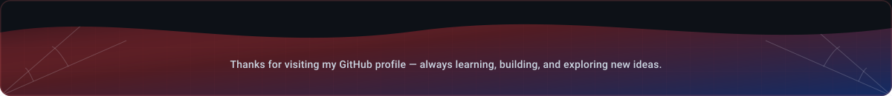

  

  

---

## About Me

I am a developer based in India focused on Web Development and Full Stack Development. I enjoy turning ideas into clean, functional websites while continuously learning modern tools and building practical projects.

- **Location:** India
- **Current Focus:** Web Development & Full Stack Development
- **Interests:** Programming, building websites, learning new technologies, and developing innovative projects.
- **GitHub:** [@sourabhsin-17](https://github.com/sourabhsin-17)

---

## Technologies & Tools I'm Working With

> *Actively learning and building projects with these languages, frameworks, and tools.*

  

---

## Featured Projects

<table width="100%">
  <tr>
    <td width="32%" valign="top">
      <strong>CampusConnect</strong> 
      Student Community & Campus Utility Platform
    </td>
    <td width="68%" valign="top">
      A student-focused platform designed to connect students and provide useful campus-related features in one accessible place.  
          
    </td>
  </tr>
  <tr>
    <td width="32%" valign="top">
      <strong>CampusBite</strong> 
      Campus Food Web Application
    </td>
    <td width="68%" valign="top">
      A campus food-related web application built to streamline discovering and browsing campus dining options.  
          
    </td>
  </tr>
  <tr>
    <td width="32%" valign="top">
      <strong>SyncBeats</strong> 
      Music-Focused Web Application
    </td>
    <td width="68%" valign="top">
      A music-focused web application crafted around clean playback interfaces and responsive frontend interactions.  
         
    </td>
  </tr>
</table>

---

## GitHub Activity & Statistics

  
  

  

  

---

## Connect With Me

  
  

---

  

<!--
**sourabhsin-17/sourabhsin-17** is a ✨ _special_ ✨ repository because its `README.md` (this file) appears on your GitHub profile.

Here are some ideas to get you started:

- 🔭 I’m currently working on ...
- 🌱 I’m currently learning ...
- 👯 I’m looking to collaborate on ...
- 🤔 I’m looking for help with ...
- 💬 Ask me about ...
- 📫 How to reach me: ...
- 😄 Pronouns: ...
- ⚡ Fun fact: ...
-->
